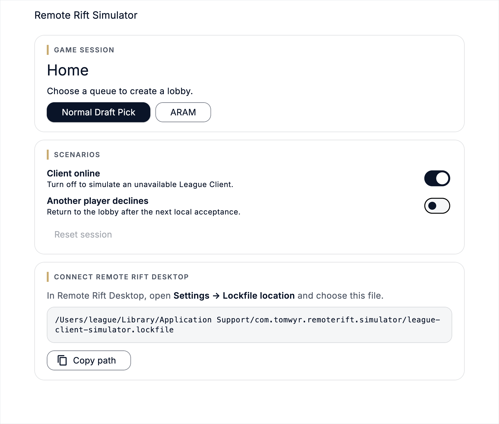

# Remote Rift Simulator

Desktop application for **Remote Rift** that simulates the League Client.

## Overview

Remote Rift Simulator is available for Windows and macOS. It lets developers
exercise Remote Rift Desktop's League Client connection and MCP integration
without playing a live match. It simulates the League Client from lobby
creation through simulated game completion.

## Architecture

The project is implemented in Flutter, targeting Windows and macOS from a
single shared codebase.

### Code structure

- **Server** - Serves the League Client API over authenticated HTTPS on
  localhost and writes the simulator's lockfile.
- **Simulation** - Manages the lobby, gameflow, timers, and offline champion
  and spell catalogs.
- **UI** - Uses widgets and a cubit to display session state and provide
  scenario controls.

### Dependencies

- [Shelf](https://pub.dev/packages/shelf) - HTTP request handling for the
  simulated League Client API.
- [Bloc](https://pub.dev/packages/bloc) - State management for the simulator
  window.
- [Slang](https://pub.dev/packages/slang) - Localization code generation from
  YAML files.

## Usage

1. From the repository root, run `just simulator-run macos` or
   `just simulator-run windows` on the matching host.
2. In the simulator, select **Copy path** under **Connect Remote Rift Desktop**.
   On the same computer, open
   **Settings → Lockfile location → Choose custom location** in Remote Rift
   Desktop and select the simulator's lockfile. Wait for Desktop to show
   **League client connected**.
3. Create a lobby and start matchmaking. Drive the session from the
   simulator or through
   [Desktop's MCP integration](../desktop/README.md#ai-integrations).

To reconnect Desktop to the real League Client, select **Reset to default** in
its lockfile settings. Mobile testing requires a separate development Connector
configured to read the simulator's lockfile.

## Development

1. Ensure Flutter is installed.
2. Run `flutter pub get` from the repository root to install dependencies.
3. From `apps/simulator`, run `dart run slang` to generate localization code.
4. Run the application from the same directory using `flutter run` or launch
   it from an IDE.
5. After modifying source files, restart the application or use hot reload.

### Building project

Run `flutter build windows` or `flutter build macos` from `apps/simulator` to
compile the application for the target platform.

### Localization

1. Edit the YAML files in `lib/i18n`.
2. Run `dart run slang` from `apps/simulator` to regenerate localization code.
3. Reload the application to apply the changes.

## Related Projects

- [Remote Rift Desktop](../desktop) - Connects to the simulator through its
  custom lockfile setting.
- [Remote Rift Core](../../packages/core) - Provides the shared League Client
  wire models.
